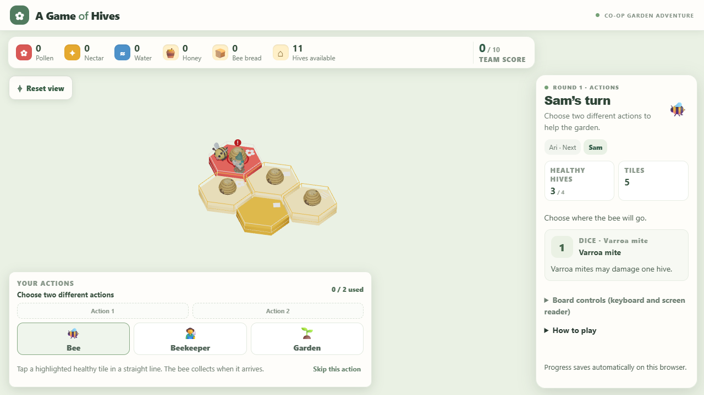
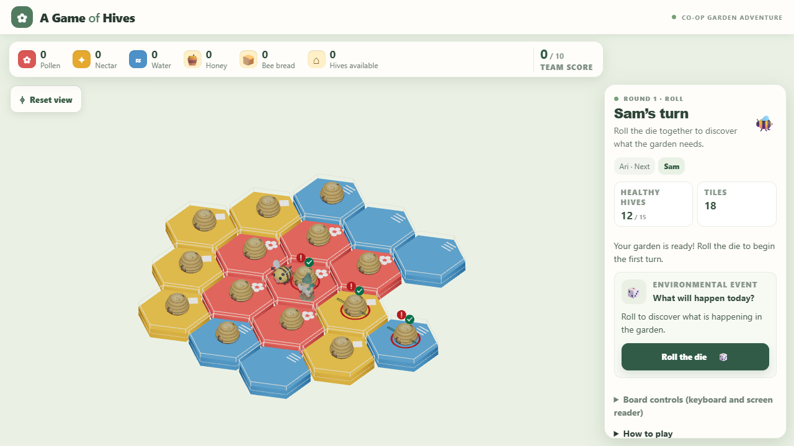

# Milestone 3: coloured model integration

This implements the supplied `COPILOT_PROMPT_MODELS.md`: replace the three placeholder pieces with the prepared assets, preserve interaction and rules, and add simple idle motion. It starts the graphical milestone; it does not claim completion of every graphical improvement in the master roadmap.

## Assets and rendering

The import notes, manifest and reference PNGs were present in `public/models/`, but the six GLBs were missing. The matching `A_Game_of_Hives_Coloured_3D_Models.zip` in Downloads supplied the GLBs copied into `public/models/`. Existing import documents and reference previews were preserved.

| Piece | Loaded file | Wrapper scale | Triangles |
| --- | --- | ---: | ---: |
| Bee | `bee.glb` | 0.78 | 26,258 |
| Beekeeper gnome | `beekeeper.glb` | 0.70 | 42,998 |
| Round skep hive | `hive.glb` | 0.90 | 8,500 |

All models use Y-up, face +Z and retain their base origin. The hive and beekeeper bases sit at the tile surface; the bee floats above it. Offsets keep all three pieces legible when sharing a tile. The detailed GLBs remain available for comparison but have no application references or preload requests.

`GameModel` preloads only the lightweight assets with `useGLTF.preload`. Asset URLs use `import.meta.env.BASE_URL` for Pages subpath hosting. Drei `Clone` gives each piece independent transforms while sharing loaded geometries and materials. Unmounting one instance does not dispose shared cached assets.

The supplied GLBs have vertex colours but no explicit material definitions. The loader's implicit metallic material is tuned to metalness 0 / roughness 0.85 with a neutral 0.45 diffuse multiplier under the existing bright board lighting. This preserves the vertex-colour attributes, shared material identity and geometry. Authored materials in future replacements are left untouched. No new textures, environment downloads or rigs are required.

Hives retain their colours in every state. Damage is a red base ring and exclamation badge; smart-hive protection is a separate green check badge. Both badges show together when appropriate. Existing garden damage, reserve/no-spray indicators, destination highlights, camera controls and keyboard alternatives remain intact.

`Piece` forwards hits on any model mesh to the existing hex-selection handler and ignores drag clicks. It does not automatically choose a new action or change movement rules. All engine, state, inventory, scoring and event code is unchanged.

## Animation and performance

Only the bee and beekeeper animate, by adjusting their wrapper transforms. A shared timer requests frames at 20 Hz while characters are present and motion is allowed. Reduced motion restores a still pose and demand rendering. Hidden tabs and offscreen canvases stop requesting idle frames. Camera interactions continue to invalidate their own frames.

The 18-tile / 15-hive test renders 196,756 model triangles before tile geometry, status indicators and shadow passes. The 15 hive instances share one geometry and one material. This is a bounded scene check, not a measured school-device frame-rate guarantee. Hardware profiling remains a classroom/device validation task. The existing large JavaScript chunk warning remains; the three lightweight GLBs add about 1.55 MB of asset requests when the board first loads.

## Changed files

- `src/components/scene/Bee.tsx`, `Beekeeper.tsx`, `Hive.tsx`: GLB wrappers, scales, idle poses and independent hive badges.
- `src/components/scene/IsometricBoard.tsx`: base-aligned visual placement, model-hit delegation, local loading boundary and motion provider.
- `src/components/scene/GameModel.tsx`: shared loading, preloading, clone ownership and implicit material setup.
- `src/components/scene/Piece.tsx`: shared model-pointer delegation.
- `src/components/scene/SceneMotion.tsx`: shared idle clock, visibility and reduced-motion support.
- `public/models/{bee,beekeeper,hive}.glb` and their `_detailed.glb` alternatives: supplied model assets.
- `tests/unit/modelAssets.test.ts`: actual GLB parsing, vertex colours, base origins and triangle budgets.
- `tests/browser/models.spec.ts`: real mesh clicks/taps, shared clone resources, statuses, reduced motion and expanded-board previews.
- `playwright.config.ts`: one software WebGL browser at a time, avoiding concurrent GPU/CPU contention.
- `README.md`, this document and `docs/previews/milestone3-*.png`: usage, implementation notes and captured previews.

## Validation and previews

Run `npm test`, `npm run build` and `npm run test:browser`. The browser suite exercises both desktop Chromium and a touch-enabled tablet viewport. Model checks verify that only the three lightweight GLBs load, imported vertex colours remain enabled, shadows are enabled, model hits reach the engine's existing commands, both status badges coexist, and reduced motion stops idle rendering.

The screenshots below are captured from the working game using the lightweight models, with reduced motion enabled for stable previews.

